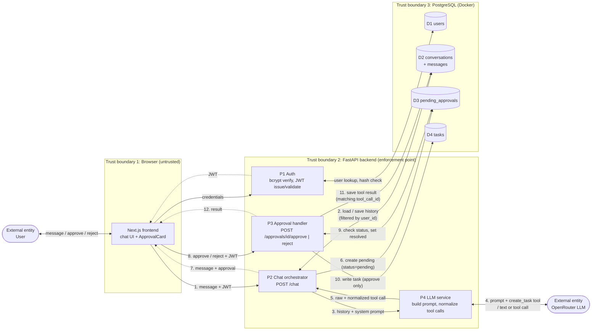

# FlowPilot

An AI assistant that turns natural-language requests into organized tasks, with a human approval gate before anything is written.

The model proposes. The user decides. Nothing happens until they approve.

## What it does

Send a message like:

> Remind me to send the invoice to Acme by Friday

The model returns a **structured tool call**, a machine-readable `{ title, description }` payload. FlowPilot does not execute it. Instead, it creates a pending approval and shows the user a card:

> **Proposed action**: Create task: *Send invoice to Acme* (By Friday)
> **Approve** · **Reject**

Only when the user clicks Approve does the backend write the task, record the tool result, and mark the approval resolved. Reject writes nothing.

That separation, propose vs. act, is the point of the project.

## Screenshots

**Proposed action, waiting for approval**


**After approval**


More in [`docs/screenshots/`](docs/screenshots/): login, empty chat, rejected approval, sidebar history, DB state, test output.

## What's built

**Product**
- Multi-user signup and login (JWT, bcrypt)
- Persistent conversations and message history (Postgres)
- LLM tool calling with a defined `create_task` contract
- Pending-approval gate: no task is written until the user approves
- Approve and reject flows, both recorded in history
- Double-approve guard (`400`)
- Per-user data isolation on every query

**Engineering**
- FastAPI + SQLAlchemy backend (Python 3.14)
- Next.js 15 (App Router) + TypeScript + Tailwind frontend
- PostgreSQL 16 via Docker Compose
- OpenRouter for the model (OpenAI-compatible SDK)
- Conversation history replayed to the model in a valid tool-call format

**Tested**
- `test_llm.py`: raw tool-calling round trip
- `test_db.py`: schema write / read / cleanup
- `test_auth.py`: bcrypt, JWT round trip, tampered-token rejection
- `test_api.py`: signup, login, duplicate signup, wrong password, `/me` with and without token
- `test_chat.py`: plain chat, task intent, approve, double-approve guard, message history, reject

## What's not built

- Auth hardening (refresh tokens, HttpOnly cookies)
- Rate limiting, structured logging, Alembic migrations
- Task edit / delete / due dates / notifications
- Hosted deployment (runs locally)

These are known gaps, not oversights.

## Architecture

### Data flow diagram

Numbered flows follow the task-creating path. Dashed boundaries are trust boundaries: every crossing is authenticated, validated, or both.



**Legend:** processes are rectangles (`P#`), data stores are cylinders (`D#`), external entities are stadium shapes. Solid arrows are requests; dashed arrows are responses.

**What the boundaries enforce**
- **TB1 to TB2:** the browser is untrusted. JWT is validated on every request; the approval gate lives in P3, not the UI.
- **TB2 to TB3:** every query filters by `user_id`. Cross-user access returns `404`.
- **TB2 to external LLM:** only the history, the system prompt, and the tool schema leave the backend. The model's output is treated as a proposal and never writes to D4 directly.

### Request flow for a task-creating message

1. `POST /chat` with `{ message, conversation_id? }`
2. Backend loads history from Postgres
3. Sends history + system prompt + `create_task` tool to the model
4. If the model returns a tool call:
   - Persist the assistant message with the **raw** API-valid tool-call shape
   - Create a `PendingApproval` with the **normalized** shape for app logic
   - Return `{ message, approval }` to the frontend
5. Frontend renders the assistant message plus an approval card
6. On **Approve**, `POST /approvals/{id}/approve` writes the task, records the tool result, marks the approval resolved
7. If the model returns plain text instead, no approval is created

## Data model

| Table | Purpose |
|---|---|
| `users` | Email + bcrypt password hash |
| `conversations` | Scoped to a `user_id` |
| `messages` | `role` in `user \| assistant \| tool`; `tool_calls` and `tool_call_id` for replay |
| `tasks` | Actual task records, scoped to a `user_id` |
| `pending_approvals` | One row per proposed action, with `status` |

Every read filters by `user_id`. Cross-user access returns `404`.

## Case study: the approval gate

When an LLM can call tools, it can change state. The moment you let it act, three questions appear:

1. How do you know the model's proposal is well-formed?
2. How do you stop it from acting on something you didn't want?
3. How do you keep its actions auditable?

FlowPilot answers all three with one pattern: **the model proposes a structured action, and a human approves before the system executes it.**

### Three concrete problems this solves

**Structured output, not text parsing.** The model returns a tool call with typed arguments. The backend never regexes a natural-language string.

**Enforcement on the server, not the UI.** The frontend shows the card, but nothing is written until `POST /approvals/{id}/approve` is called. A buggy or malicious client cannot bypass the gate.

**History replay stays API-valid.** After a tool call and approval, the conversation contains `user`, `assistant` (with tool calls), and `tool` (with a matching `tool_call_id`) messages. Sending this back to the provider on the next turn is where many implementations break. FlowPilot stores the raw API-valid shape on the assistant message and the matching `tool_call_id` on the tool message, so replay works.

### Design decisions

**Why the system prompt forces tool calls on clear task intent.** Without it, the model asks "Shall I create that?" instead of acting. The prompt sets the contract: task intent means call the tool. The approval UI is where confirmation happens.

**Why two shapes of `tool_calls` are stored.** The API needs `{ id, type: "function", function: { name, arguments } }`. App logic wants `{ id, name, args }`. The service returns both; the DB stores the API-valid one; app logic reads the normalized one.

**Why `PendingApproval` is a table.** It's the audit trail: status, `tool_call_id`, proposed arguments, timestamps. First-class, so the same pattern extends to any future consequential tool.

## Running locally

**Prerequisites:** Docker, Python 3.11+, Node 20+, an OpenRouter API key.

**Backend**

```bash
cd backend
python3 -m venv ../.venv
source ../.venv/bin/activate
pip install fastapi "uvicorn[standard]" sqlalchemy psycopg2-binary \
    pydantic-settings "passlib[bcrypt]" "bcrypt==4.0.1" \
    "python-jose[cryptography]" python-multipart python-dotenv httpx email-validator

cp .env.example .env
# edit .env: set OPENROUTER_API_KEY and JWT_SECRET

docker compose up -d
python -c "from app.db import Base, engine; from app import models; Base.metadata.create_all(bind=engine)"
python -m uvicorn app.main:app --reload --host 0.0.0.0 --port 8000
```

**Frontend**

```bash
cd frontend
npm install
echo "NEXT_PUBLIC_API_BASE=http://localhost:8000" > .env.local
npm run dev
```

Open `http://localhost:3000`, sign up, and send:

> Remind me to send the invoice to Acme by Friday


## Tech stack

Next.js · TypeScript · Tailwind · FastAPI · SQLAlchemy · PostgreSQL · OpenRouter · JWT · Docker
